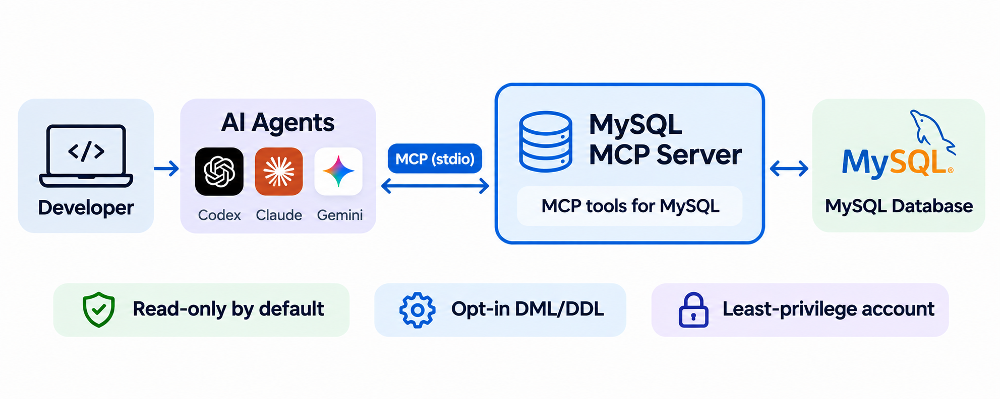

# MySQL MCP Server



Connect AI coding agents to MySQL through bounded, permission-aware MCP tools. Explore schemas, inspect tables, and run limited read-only queries by default; enable structured data and schema changes explicitly when needed, without exposing an unrestricted SQL write interface.

**Local stdio · Read-only by default · Opt-in changes · Experimental**

## Project status

**Experimental — available for controlled evaluation.** `mysql-mcp-server` is under active development and is appropriate for local testing with an isolated, masked, or otherwise non-sensitive database and a dedicated least-privilege account. It is not presented as production-ready; interfaces, operational guidance, and behavior may change before a stable release.

## Why use it?

An agent can discover the database context it is allowed to see instead of asking a developer to paste schemas into chat. The server is a local [Model Context Protocol (MCP)](https://modelcontextprotocol.org/) process, not an HTTP API or graphical application. MySQL remains the authority for effective access: the server does not elevate privileges, grant permissions, or accept arbitrary SQL for writes.

## Capabilities

| Capability    | Default  | What it provides                                                                                                           | Boundary                                                                                                              |
| ------------- | -------- | -------------------------------------------------------------------------------------------------------------------------- | --------------------------------------------------------------------------------------------------------------------- |
| **Read-only** | Enabled  | Discover accessible schemas and tables, inspect table metadata, run bounded `SELECT` queries, and inspect `EXPLAIN` plans. | Literal `LIMIT` from 0 through 100, bound parameters, and the MySQL account's effective permissions.                  |
| **DML**       | Disabled | Structured `insert_rows`, `update_rows`, and `delete_rows` operations.                                                     | Requires `MYSQL_DML_ENABLED=true`, appropriate MySQL grants, direct operator confirmation, and no automatic retry.    |
| **DDL**       | Disabled | Structured schema, table, view, index, column, constraint, and rename operations.                                          | Requires `MYSQL_DDL_ENABLED=true` plus operation-specific flags, metadata checks, and confirmations where applicable. |

The server never becomes a general SQL administration channel. Destructive operations have additional gates, errors and audit output are sanitized, and uncertain mutations are not retried automatically. See the [complete tool contract](#tool-contract) and [runtime configuration reference](docs/configuration.md) for details.

## How it works

1. A developer asks an AI client a natural-language question.
2. The client launches this local MCP server over stdio.
3. The server exposes only the bounded tools enabled by configuration.
4. MySQL enforces the configured account's privileges and object visibility.

The recommended first session is discovery → table description → bounded `SELECT` → `EXPLAIN`. A [technical SVG architecture reference](docs/assets/architecture.svg) is available for documentation and packaging checks; the illustration above is the primary README visual.

### Quick links

[Quick start](#quick-start-install-an-official-package) · [First example](#first-example) · [Security and limitations](#security-and-limitations) · [Getting started](docs/getting-started.md) · [Codex client setup](docs/clients/codex.md) · [Configuration](docs/configuration.md) · [Tool reference](#tool-contract) · [Troubleshooting](docs/troubleshooting.md) · [Releases](https://github.com/VissotoFlavio/mysql-mcp-server/releases)

## Quick start: install an official package

For the complete download-to-first-prompt flow, including Windows PowerShell and Codex, see [Getting started](docs/getting-started.md). The commands below remain the shortest package-based path. The npm package has `private: true` in `package.json` and is not published to npm; use a stable asset from the [GitHub Releases](https://github.com/VissotoFlavio/mysql-mcp-server/releases) page.

This is the shortest path for a user who does not have a repository clone. Download the `.tgz` asset from an official GitHub Release, choose a dedicated local install directory, and install the package with its production dependencies. Candidate packages from prereleases are for controlled validation only.

Before starting, have Node.js 22 or later, npm, a reachable MySQL server, a dedicated least-privilege account, and an MCP client that can launch a local stdio process. Keep credentials and TLS material in the launching environment or a local untracked file.

### 1. Install the release package

```bash
npm install --omit=dev --prefix "/absolute/path/to/mysql-mcp-server" "/absolute/path/to/downloads/mysql-mcp-server-<version>.tgz"
```

### 2. Configure the minimum safe environment

Copy the packaged blank-variable template to a local, untracked file. Edit that file on the machine that will launch the server; do not put credentials or TLS material in the MCP client's JSON configuration.

```bash
cp "/absolute/path/to/mysql-mcp-server/node_modules/mysql-mcp-server/.env.example" "/absolute/path/to/mysql-mcp-server/.env"
# edit /absolute/path/to/mysql-mcp-server/.env
node --env-file="/absolute/path/to/mysql-mcp-server/.env" "/absolute/path/to/mysql-mcp-server/node_modules/mysql-mcp-server/dist/server.js"
```

On PowerShell, use `Copy-Item` for the copy step:

```powershell
npm install --omit=dev --prefix 'C:\path\to\mysql-mcp-server' 'C:\path\to\downloads\mysql-mcp-server-<version>.tgz'
Copy-Item 'C:\path\to\mysql-mcp-server\node_modules\mysql-mcp-server\.env.example' 'C:\path\to\mysql-mcp-server\.env'
node --env-file='C:\path\to\mysql-mcp-server\.env' 'C:\path\to\mysql-mcp-server\node_modules\mysql-mcp-server\dist\server.js'
```

### 3. Register the local MCP process

The installed executable is `.../node_modules/.bin/mysql-mcp-server` (`mysql-mcp-server.cmd` on Windows). Use that path when the MCP client can inject environment variables itself. When using a local `.env` file, invoke `node` as above so `--env-file` is processed before the server script.

The generic MCP client process configuration is:

```json
{
  "mcpServers": {
    "mysql-local": {
      "command": "node",
      "args": [
        "--env-file=/absolute/path/to/mysql-mcp-server/.env",
        "/absolute/path/to/mysql-mcp-server/node_modules/mysql-mcp-server/dist/server.js"
      ]
    }
  }
}
```

For Codex, the equivalent entry in `config.toml` is:

```toml
[mcp_servers.mysql-local]
command = "node"
args = [
  "--env-file=/absolute/path/to/mysql-mcp-server/.env",
  "/absolute/path/to/mysql-mcp-server/node_modules/mysql-mcp-server/dist/server.js",
]
```

Adapt the property names to the selected MCP client. This example contains no credentials. Prefer the client's secret or environment injection mechanism when available, then omit `--env-file` and pass only the required `MYSQL_*` values to the child process. The child process uses stdio: its stdout is reserved for MCP protocol messages, so do not add banners, `console.log` output, or a wrapper that writes status text there; operational logs belong on stderr.

After adding or changing the server entry, restart or reload the MCP client before starting the first session.

### 4. Start the first safe session

With `MYSQL_DML_ENABLED=false` and `MYSQL_DDL_ENABLED=false`, start by discovering only what the account can see:

1. Call `list_accessible_schemas`.
2. Call `list_accessible_tables` for one returned schema.
3. Call `describe_table` for one returned table.
4. Call `execute_read_only_query` with one policy-approved `SELECT`, bound `parameters`, and a literal `LIMIT` from 0 through 100.
5. Call `explain_read_only_query` with the same approved query and parameters; do not prepend `EXPLAIN`.

The default session registers only the five bounded read-only tools. Leave DML and DDL disabled until the workflow, target, privileges, and recovery plan are explicit.

## First example

These prompts are intentionally independent of any particular schema or table:

1. **Schema discovery:** “List the MySQL schemas and tables accessible to my account.”
2. **Table inspection:** “Choose an accessible table and describe its columns and keys.”
3. **Read-only query:** “Based on the discovered table structure, propose a bounded `SELECT` using existing columns and a literal `LIMIT 5`.”
4. **Query analysis:** “Explain the execution plan for the approved read-only query; do not execute DML.”

If discovery returns no suitable table or columns, stop at metadata. Any example object names elsewhere in this README are illustrative; use only objects visible to the configured account.

## Documentation

- [Getting started](docs/getting-started.md): complete release-package onboarding for POSIX shells, PowerShell, and Codex.
- [Codex client setup](docs/clients/codex.md): client-specific stdio registration.
- [Runtime configuration](docs/configuration.md): variable types, defaults, and opt-in boundaries.
- [Tool contract](#tool-contract): detailed read-only, DML, and DDL behavior.
- [Sanitized workflow demo](docs/sanitized-workflow-demo.md): synthetic discovery, query, and operator-reviewed write transcript.
- [Troubleshooting](docs/troubleshooting.md): symptom-based startup, configuration, and client guidance.

## Security and limitations

Use one dedicated MySQL account with only the minimum permissions required for the enabled capabilities. When `MYSQL_DML_ENABLED=true`, that account must also have the intended DML privileges on the target objects. When `MYSQL_DDL_ENABLED=true`, it must additionally have narrowly scoped `SELECT` for metadata and duplicate preflight plus only the intended `CREATE`, `INDEX`, and `ALTER` privileges, `DROP` on a rename source or explicitly confirmed view, `INSERT` on a rename destination, and (for foreign keys) `REFERENCES` privileges in the isolated target schema. The controlled view workflow needs `CREATE VIEW` on the target schema plus actual source-column `SELECT`; its generated view always uses `SQL SECURITY INVOKER` and never accepts a definer. The server neither grants nor elevates database permissions and does not require a separate DML or DDL credential; `drop_schema` is the exception that also requires its explicit local allowlist.

For `create_view`, the required privilege is not metadata access alone: grant `CREATE VIEW` in the target schema and narrowly scoped actual `SELECT` on every projected source table/column. The view is always `SQL SECURITY INVOKER`; no client-supplied definer is accepted.

For `create_schema`, enable `MYSQL_DDL_CREATE_SCHEMA_ENABLED=true` only alongside `MYSQL_DDL_ENABLED=true`, use a dedicated account with metadata visibility and the `CREATE` privilege that covers the target database (depending on the server's grant setup, this may require a global or database-level grant), and explicitly verify the intended target and cleanup plan. Do not grant `CREATE USER`, `GRANT OPTION`, or broader administrative privileges. The tool never changes `MYSQL_DATABASE`, grants privileges, or retries an uncertain submission.

For `drop_schema`, enable `MYSQL_DDL_DROP_SCHEMA_ENABLED=true` only alongside `MYSQL_DDL_ENABLED=true` and provide `MYSQL_DDL_DROP_SCHEMA_ALLOWLIST` as an exact comma-separated list of disposable schema identifiers. The allowlist must be non-empty for registration, must never contain `MYSQL_DATABASE` or a protected system schema, and does not replace MySQL authorization. The operation is supported only for a schema with at least one visible InnoDB base table exposing a durable `TABLE_ID`; empty or no-anchor schemas fail closed. The account needs only the metadata visibility and `DROP` privilege required for the explicitly approved lifecycle; take and verify backups, schedule a controlled maintenance window, and confirm recovery before proceeding. The impact snapshot is not a cross-session lock: concurrent external DDL can make it stale, so verify the target after the operation.

## Use cases

Use the registered tools to turn focused natural-language questions into a bounded workflow:

| Developer prompt                                                            | Tool                      | Example request                                                                                                                                 |
| --------------------------------------------------------------------------- | ------------------------- | ----------------------------------------------------------------------------------------------------------------------------------------------- |
| "Which schemas can I inspect with this account?"                            | `list_accessible_schemas` | List the schemas visible to the configured MySQL account.                                                                                       |
| "What tables and views are available in `example_catalog`?"                 | `list_accessible_tables`  | Send `{ "schema": "example_catalog" }`.                                                                                                         |
| "Describe the columns and keys in `example_catalog.sample_records`."        | `describe_table`          | Send `{ "schema": "example_catalog", "table": "sample_records" }`.                                                                              |
| "Show the five latest permitted records, breaking ties by the primary key." | `execute_read_only_query` | Send `SELECT record_id, created_at FROM example_catalog.sample_records ORDER BY created_at DESC, record_id DESC LIMIT 5` with `parameters: []`. |
| "Before running that bounded query, how will MySQL plan it?"                | `explain_read_only_query` | Send the same policy-approved `SELECT` and parameters; do not prepend `EXPLAIN`.                                                                |

The identifiers in these prompts are illustrative. Use only objects visible to the configured account, bind values through `parameters`, and include a literal `LIMIT` from 0 through 100 in every query. A prompt asking for the "latest" records must specify a deterministic `ORDER BY` and a literal limit, as in the example above.

### Instructions for an AI agent using DML

Treat DML as a distinct, state-changing workflow. Follow this sequence whenever the MCP session advertises `insert_rows`, `update_rows`, or `delete_rows`:

1. Confirm that the requested DML tool is present. Its presence means DML was enabled for this server process; it does **not** mean the configured MySQL account has permission to modify every object.
2. Discover the accessible schema and table, then call `describe_table` before constructing a write. Do not guess table names, columns, generated values, or relationships.
3. State the intended operation to the operator: schema and table, inserted values or updated values, exact filters, requested limit, and the concise audit `reason`. For a delete, also consider foreign-key cascade effects; they are enforced by MySQL and are not reflected as separate MCP writes.
4. Execute a DML call only when the user has directly requested that specific change or has explicitly confirmed the stated operation. Use the dedicated DML tool, never arbitrary SQL.
5. Inspect the structured result. A successful `update_rows` can report zero `matchedRows`; a successful `delete_rows` can report zero `affectedRows`. Report the result rather than assuming the requested rows existed or changed.
6. When the result is `MYSQL_PERMISSION_DENIED`, report that the configured database account lacks the required permission. Do not attempt grants, credential changes, or a different write on the agent's own initiative.
7. When the result is `MYSQL_DML_OUTCOME_UNKNOWN` or includes `retryAdvice: "VERIFY_STATE_BEFORE_RETRYING"`, use a bounded read-only query to verify the database state before deciding with the operator whether another write is appropriate. Never automatically retry a DML request.
8. After a known successful mutation, use a bounded read-only query when practical to verify the expected state. Do not treat a successful transport response as authorization to perform an additional mutation.

### Instructions for an AI agent using controlled DDL

Treat every controlled DDL tool as a distinct schema-changing workflow. It is present only when `MYSQL_DDL_ENABLED=true`; its presence does not prove that the configured MySQL account may change every table.

1. Discover the intended schema and confirm the exact structured request with the operator. `create_schema` requires both DDL flags and exactly `{ schema, charset?, collation?, reason }`; the target must be absent and may differ from `MYSQL_DATABASE`, which remains only the connection context. If a collation is supplied, its charset must also be supplied and both must be allowlisted. For a foreign key this includes the local and referenced table/column lists, constraint name, both explicit actions, and concise audit reason. Do not infer a definition from prose and do not construct SQL.
2. Call a controlled DDL tool only when the operator has directly requested or explicitly confirmed that exact schema change. `create_schema` emits one internally constructed `CREATE SCHEMA` without `IF NOT EXISTS`, tables, grants, users, roles, or arbitrary options. `create_view` requires confirmation of exactly `{ schema, view, definition: { table, columns }, reason }` and permits only a same-schema projection of distinct visible source columns; it never accepts SQL, expressions, aliases, joins, filters, ordering, parameters, CTEs, `DEFINER`, or options. `drop_view` requires exactly `{ schema, view, reason, confirmation: "DROP_VIEW" }`, rejects known dependent views, and never accepts `IF EXISTS`, `CASCADE`, or multiple targets. `drop_table` requires a target-bound `DROP_TABLE:<metadataRevision>` confirmation from a recent `describe_table` result, rejects known dependent views, foreign keys, and triggers, and never accepts `IF EXISTS`, `CASCADE`, or multiple targets. The foreign-key tool is limited to a single intra-schema constraint with 1–16 ordered local/referenced columns, existing compatible indexed columns, and explicit `RESTRICT` or `NO ACTION` actions. The column-modification tool accepts only the documented same-family widening matrix and rejects foreign-key dependencies, narrowing, ambiguous conversions, and unmodeled defaults. `drop_index` requires explicit confirmation of `{ schema, table, index, reason }` and accepts only a removable secondary non-unique B-tree after metadata and foreign-key dependency checks. It never creates indexes, accepts `CASCADE`/`SET NULL`, or permits cross-schema references. Arbitrary DDL, migrations, grants, and generic SQL execution remain unavailable.
3. For `drop_schema`, call the same tool first without `confirmation` to obtain bounded base-table names and counts plus a short-lived `DROP_SCHEMA:<metadataRevision>` token. Schemas containing views, routines, events, or triggers are rejected before confirmation. Review backups, recovery, consumers, and the maintenance window; then send the exact schema, a concise reason, and that confirmation. The server rechecks the snapshot, consumes the token once, verifies absence afterward, and never accepts SQL, `IF EXISTS`, `CASCADE`, multiple targets, grants, or automatic retry.
4. Report the sanitized result. A successful view response contains only `operation`, `operationId`, `target`, `source`, and `warnings`; other DDL results contain only their documented operation metadata. No response returns SQL or the submitted reason.
5. If the result is `MYSQL_DDL_OUTCOME_UNKNOWN` or includes `retryAdvice: "VERIFY_STATE_BEFORE_RETRYING"`, inspect the target through the read-only discovery tools before any new request. Do not retry automatically.
6. For `MYSQL_DDL_PERMISSION_DENIED`, `MYSQL_DDL_TABLE_EXISTS`, lock/deadlock, or structural failures, report the safe outcome and obtain a new operator-approved request before another mutation. Do not change credentials, grants, or the requested definition autonomously.

The server provides only documented controlled DDL tools when DDL is enabled; it never exposes arbitrary DDL or a general SQL write endpoint.

## Sanitized workflow demo

The [sanitized MCP workflow transcript](docs/sanitized-workflow-demo.md) shows metadata discovery, object description, a bounded query and plan inspection, followed by an operator-reviewed insert, update, delete, and result-handling guidance. It is backed by a reproducible in-memory MCP test that uses only synthetic data; no database connection, credential, hostname, certificate, internal identifier, or production query result is present.

## Install from source, build, and start

The lockfile makes the dependency installation reproducible:

```bash
npm ci
npm run build
```

Copy the tracked blank-variable template to an untracked local file and fill it only on the machine or secret store that launches the server. The application reads its configuration from the process environment; Node 22 can load that local file with `--env-file`.

```bash
cp .env.example .env
node --env-file=.env dist/server.js
```

On PowerShell, use `Copy-Item .env.example .env` for the copy step. Never commit the resulting `.env` file. If a process supervisor or MCP client injects environment variables itself, start `node dist/server.js` instead.

The command above is a long-running stdio server. Its standard output is reserved exclusively for MCP protocol messages. Do not add `console.log` output, shell banners, log-forwarding wrappers, or package-manager status messages to stdout. Send operational logs to stderr. If a wrapper is unavoidable, use one that is silent on stdout; for the provided script, that is `npm --silent start` with the environment already supplied externally.

## Runtime configuration

All configuration is validated at startup. The values below are names and constraints, not sample credentials. Keep the values in the launching process or a local secret-managed file.

| Variable                                      | Required | Constraint or default                                                                                                          |
| --------------------------------------------- | -------- | ------------------------------------------------------------------------------------------------------------------------------ |
| `MYSQL_HOST`                                  | Yes      | Hostname or IPv4 address only; no scheme, port, or path.                                                                       |
| `MYSQL_PORT`                                  | No       | Integer 1–65535; defaults to 3306.                                                                                             |
| `MYSQL_DATABASE`                              | Yes      | Non-empty identifier up to 64 characters; no NUL or line breaks.                                                               |
| `MYSQL_USER`                                  | Yes      | Non-empty identifier up to 64 characters; no NUL or line breaks.                                                               |
| `MYSQL_PASSWORD`                              | Yes      | Non-empty value.                                                                                                               |
| `MYSQL_POOL_LIMIT`                            | No       | Integer 1–2; defaults to 2.                                                                                                    |
| `MYSQL_QUEUE_LIMIT`                           | No       | Integer 1–100; defaults to 10.                                                                                                 |
| `MYSQL_CONNECT_TIMEOUT_MS`                    | No       | Integer 100–60000; defaults to 5000.                                                                                           |
| `MYSQL_QUERY_TIMEOUT_MS`                      | No       | Integer 100–60000; defaults to 30000.                                                                                          |
| `MYSQL_IDLE_TIMEOUT_MS`                       | No       | Integer 1000–3600000; defaults to 60000.                                                                                       |
| `MYSQL_TLS`                                   | No       | `true` enables TLS; defaults to `false`.                                                                                       |
| `MYSQL_TLS_REJECT_UNAUTHORIZED`               | No       | May only be `true`; peer verification cannot be disabled.                                                                      |
| `MYSQL_TLS_CA_FILE`                           | No       | Path to externally managed CA material; requires `MYSQL_TLS=true`.                                                             |
| `MYSQL_TLS_CERT_FILE`                         | No       | Path to externally managed client certificate material; requires `MYSQL_TLS=true`.                                             |
| `MYSQL_TLS_KEY_FILE`                          | No       | Path to externally managed client key material; requires `MYSQL_TLS=true`.                                                     |
| `MYSQL_DML_ENABLED`                           | No       | `true` conditionally registers `insert_rows`, `update_rows`, and `delete_rows`; defaults to `false`.                           |
| `MYSQL_DDL_ENABLED`                           | No       | `true` conditionally registers the bounded DDL tools; defaults to `false`.                                                     |
| `MYSQL_DDL_CREATE_SCHEMA_ENABLED`             | No       | `true` conditionally registers `create_schema` in addition to `MYSQL_DDL_ENABLED=true`; defaults to `false`.                   |
| `MYSQL_DDL_CREATE_SCHEMA_INTEGRATION_TEST`    | No       | `true` enables the separately authorized schema create/drop integration test; defaults to unset/false.                         |
| `MYSQL_DDL_CREATE_SCHEMA_INTEGRATION_CONFIRM` | No       | Must be `isolated-schema-create-drop` for that schema-mutating integration test; no default.                                   |
| `MYSQL_DDL_DROP_VIEW_METADATA_COMPLETE`       | No       | Must be `true` to call `drop_view`; operator attests complete dependency metadata visibility; defaults to `false`.             |
| `MYSQL_DDL_DROP_COLUMN_ENABLED`               | No       | `true` enables the destructive DROP COLUMN capability only with `MYSQL_DDL_ENABLED=true`; defaults to `false`.                 |
| `MYSQL_DDL_DROP_COLUMN_METADATA_COMPLETE`     | No       | Must be `true` with the DROP COLUMN opt-in; operator attests complete dependency metadata visibility; defaults to `false`.     |
| `MYSQL_DDL_DROP_TABLE_ENABLED`                | No       | `true` enables the destructive DROP TABLE capability only with `MYSQL_DDL_ENABLED=true`; defaults to `false`.                  |
| `MYSQL_DDL_DROP_TABLE_METADATA_COMPLETE`      | No       | Must be `true` with the DROP TABLE opt-in; operator attests complete dependency metadata visibility; defaults to `false`.      |
| `MYSQL_DDL_DROP_SCHEMA_ENABLED`               | No       | `true` enables DROP SCHEMA with DDL and a non-empty allowlist; defaults to `false`.                                            |
| `MYSQL_DDL_DROP_SCHEMA_ALLOWLIST`             | No       | Exact disposable schema names; rejects duplicates, `MYSQL_DATABASE`, protected system schemas, controls, and quotes.           |
| `MYSQL_DDL_DROP_SCHEMA_INTEGRATION_TEST`      | No       | `true` enables the separately authorized disposable-schema integration test; defaults to unset/false.                          |
| `MYSQL_DDL_DROP_SCHEMA_INTEGRATION_CONFIRM`   | No       | Must be `isolated-schema-create-drop` for that schema-mutating integration test; no default.                                   |
| `MYSQL_DDL_DROP_SCHEMA_INTEGRATION_SCHEMA`    | No       | Disposable target beginning with `mcp_ddl_test_`; sole allowlisted schema, case-insensitively distinct from `MYSQL_DATABASE`.  |
| `MYSQL_DDL_TRUNCATE_TABLE_ENABLED`            | No       | `true` enables the destructive TRUNCATE TABLE capability only with `MYSQL_DDL_ENABLED=true`; defaults to `false`.              |
| `MYSQL_DDL_TRUNCATE_TABLE_METADATA_COMPLETE`  | No       | Must be `true` with the TRUNCATE TABLE opt-in; operator attests complete foreign-key metadata visibility; defaults to `false`. |

TLS files are read only after TLS is explicitly enabled. Startup and tool errors are intentionally safe: they guide an operator to check configuration, connectivity, parameters, or permissions without returning credentials, certificate contents, or raw database errors.

## Configure an MCP client safely

Configure the client to launch the built server as a local child process. The generic process contract is:

- executable: `node`
- arguments: `--env-file=/absolute/path/to/mysql-mcp-server/.env` followed by `/absolute/path/to/mysql-mcp-server/dist/server.js`
- transport: stdio

Those paths are placeholders, not a client-specific configuration format. Use the syntax required by the chosen client, and keep secrets out of that configuration. Prefer the client's secret/environment injection mechanism when it has one; then omit `--env-file` and supply the required `MYSQL_*` values to the child process. The client must leave the child's stdout unmodified because it carries MCP messages.

## Tool contract

`truncate_table` is advertised only when `MYSQL_DDL_ENABLED=true`, `MYSQL_DDL_TRUNCATE_TABLE_ENABLED=true`, and `MYSQL_DDL_TRUNCATE_TABLE_METADATA_COMPLETE=true`. It accepts exactly `{ schema, table, reason, confirmation }`, where confirmation is `TRUNCATE_TABLE:<metadataRevision>` from the current `describe_table` result. The target must be one existing `BASE TABLE` with no known foreign-key relationship. The result includes stable `effects` for auto-increment reset, implicit commit/non-rollback, and metadata locks; malformed or unavailable metadata, permission, structure, lock/deadlock, and indeterminate outcomes are sanitized and never automatically retried.

When `MYSQL_DDL_ENABLED=true`, the controlled `alter_table_drop_foreign_key` tool is also advertised. It accepts exactly `{ schema, table, constraint, reason }` and removes only the named foreign key after metadata preflight; supporting indexes, columns, and other constraints are preserved. The destructive `alter_table_drop_column` and `drop_table` tools require their separate destructive opt-ins and metadata-visibility attestations as well.

The server registers these five read-only tools by default. When `MYSQL_DML_ENABLED=true`, it also registers the controlled `insert_rows`, `update_rows`, and `delete_rows` tools. When `MYSQL_DDL_ENABLED=true`, it additionally registers the controlled `create_table`, `create_view`, `create_index`, `create_unique_index`, `drop_index`, `alter_table_add_column`, `alter_table_add_foreign_key`, `alter_table_drop_foreign_key`, `alter_table_modify_column`, `alter_table_rename_column`, and `rename_table` tools. When both `MYSQL_DDL_ENABLED=true` and `MYSQL_DDL_CREATE_SCHEMA_ENABLED=true`, it also registers `create_schema`; when `MYSQL_DDL_ENABLED=true` and `MYSQL_DDL_DROP_VIEW_METADATA_COMPLETE=true`, it registers `drop_view`; when all three of `MYSQL_DDL_ENABLED=true`, `MYSQL_DDL_DROP_COLUMN_ENABLED=true`, and `MYSQL_DDL_DROP_COLUMN_METADATA_COMPLETE=true` are set, it registers `alter_table_drop_column`; when all three of `MYSQL_DDL_ENABLED=true`, `MYSQL_DDL_DROP_TABLE_ENABLED=true`, and `MYSQL_DDL_DROP_TABLE_METADATA_COMPLETE=true` are set, it registers `drop_table`; when all three of `MYSQL_DDL_ENABLED=true`, `MYSQL_DDL_TRUNCATE_TABLE_ENABLED=true`, and `MYSQL_DDL_TRUNCATE_TABLE_METADATA_COMPLETE=true` are set, it registers `truncate_table`; when `MYSQL_DDL_ENABLED=true`, `MYSQL_DDL_DROP_SCHEMA_ENABLED=true`, and `MYSQL_DDL_DROP_SCHEMA_ALLOWLIST` is non-empty, it registers `drop_schema`. Successful calls include `structuredContent` and a JSON text representation of the same result, so integrations can consume the documented object shapes. `describe_table` also returns a short-lived, target-bound opaque `metadataRevision` used once to bind `drop_table` or `truncate_table` confirmations. Metadata is deterministically ordered; query row order remains the order returned by MySQL, so clients should use SQL ordering when they require it.

| Tool                           | Input                                                                                                                                                                                                                                                                                                                                                                                                                                                                                                                                                                                                                   | Structured result and limits                                                                                                                                                                                                                                                                                                                                                                                                             |
| ------------------------------ | ----------------------------------------------------------------------------------------------------------------------------------------------------------------------------------------------------------------------------------------------------------------------------------------------------------------------------------------------------------------------------------------------------------------------------------------------------------------------------------------------------------------------------------------------------------------------------------------------------------------------- | ---------------------------------------------------------------------------------------------------------------------------------------------------------------------------------------------------------------------------------------------------------------------------------------------------------------------------------------------------------------------------------------------------------------------------------------- |
| `list_accessible_schemas`      | No input.                                                                                                                                                                                                                                                                                                                                                                                                                                                                                                                                                                                                               | `{ metadata: [{ schemaName }] }`; at most 100 schemas, ordered by schema name ascending.                                                                                                                                                                                                                                                                                                                                                 |
| `list_accessible_tables`       | Exactly `{ schema }`, where `schema` is a non-empty string of at most 64 characters.                                                                                                                                                                                                                                                                                                                                                                                                                                                                                                                                    | `{ metadata: [{ schemaName, tableName, tableType }] }`; at most 100 tables or views in that schema, ordered by schema then table name ascending.                                                                                                                                                                                                                                                                                         |
| `describe_table`               | Exactly `{ schema, table }`; each is a non-empty identifier of at most 64 characters and has no control characters.                                                                                                                                                                                                                                                                                                                                                                                                                                                                                                     | `{ table: { schemaName, tableName, tableType }, columns: [{ columnName, dataType, isNullable, columnKey }], metadataRevision }`; describes one accessible table or view, returns at most 100 columns in ordinal position order, and exposes a short-lived opaque revision used once by `drop_table` or `truncate_table`.                                                                                                                 |
| `execute_read_only_query`      | Exactly `{ sql, parameters }`. `sql` is 1–10000 characters; `parameters` has at most 100 JSON scalars (`string`, finite `number`, `boolean`, or `null`), with strings up to 8192 characters.                                                                                                                                                                                                                                                                                                                                                                                                                            | `{ columns: [{ name, type }], rows: [...] }`; at most 100 columns, 100 rows, and 512 KiB of serialized JSON. Values are JSON-compatible; returned big integers are strings, dates are ISO timestamps, and binary values are base64 strings.                                                                                                                                                                                              |
| `explain_read_only_query`      | The same input and validation as `execute_read_only_query`. Send the SELECT or CTE itself, not an `EXPLAIN` statement.                                                                                                                                                                                                                                                                                                                                                                                                                                                                                                  | The same bounded `{ columns, rows }` shape, containing the MySQL `EXPLAIN` result. It uses `EXPLAIN`, never `EXPLAIN ANALYZE`.                                                                                                                                                                                                                                                                                                           |
| `insert_rows`                  | Only when `MYSQL_DML_ENABLED=true`. Exactly `{ schema, table, rows, reason }`; 1–100 rows, shared columns, bounded payload/columns/parameters, and no generated, invisible, or `AUTO_INCREMENT` columns.                                                                                                                                                                                                                                                                                                                                                                                                                | `{ operation: "insert", operationId, target, affectedRows, insertId, warnings }`; values are sent as prepared parameters, and errors are sanitized. No retry is performed.                                                                                                                                                                                                                                                               |
| `update_rows`                  | Only when `MYSQL_DML_ENABLED=true`. Exactly `{ schema, table, values, filters, limit, reason }`; filters are required, bounded, and the limit is 1–100.                                                                                                                                                                                                                                                                                                                                                                                                                                                                 | `{ operation: "update", operationId, target, matchedRows, affectedRows, changedRows, warningCount }`; values and filters are prepared parameters, and errors are sanitized. No retry is performed.                                                                                                                                                                                                                                       |
| `delete_rows`                  | Only when `MYSQL_DML_ENABLED=true`. Exactly `{ schema, table, filters, limit, reason }`; filters are required, bounded, and the limit is 1–100.                                                                                                                                                                                                                                                                                                                                                                                                                                                                         | `{ operation: "delete", operationId, target, affectedRows, warningCount }`; filters are prepared parameters, and errors are sanitized. No retry is performed.                                                                                                                                                                                                                                                                            |
| `create_table`                 | Only when `MYSQL_DDL_ENABLED=true`. Exactly `{ schema, table, columns, primaryKey, reason }`; column types are limited to the documented structured MySQL 8.4 subset, with at most 100 columns.                                                                                                                                                                                                                                                                                                                                                                                                                         | `{ operation: "create_table", operationId, target, warnings }`; the definition is internally constructed and audited. Errors use stable `MYSQL_DDL_*` safe codes. No retry is performed.                                                                                                                                                                                                                                                 |
| `create_schema`                | Only when both `MYSQL_DDL_ENABLED=true` and `MYSQL_DDL_CREATE_SCHEMA_ENABLED=true`. Exactly `{ schema, charset?, collation?, reason }`; the target must be absent, options are allowlisted, and `collation` requires its matching `charset`. SQL, expressions, quoted identifiers, `IF NOT EXISTS`, tables, grants, users, roles, and arbitrary options are rejected.                                                                                                                                                                                                                                                   | `{ operation: "create_schema", operationId, target: { schema, charset?, collation? }, warnings }`; bounded `SCHEMATA` preflight, canonical internal SQL, and sanitized audit are mandatory. `MYSQL_DDL_SCHEMA_EXISTS`, permission, metadata, structure, lock/deadlock, and indeterminate outcomes are safe and never automatically retried.                                                                                              |
| `create_view`                  | Only when `MYSQL_DDL_ENABLED=true`. Exactly `{ schema, view, definition: { table, columns }, reason }`; one same-schema base table and 1–100 distinct visible columns only. No SQL, expressions, aliases, joins, filters, ordering, parameters, CTEs, `DEFINER`, or options are accepted. Explicit operator confirmation is required.                                                                                                                                                                                                                                                                                   | `{ operation: "create_view", operationId, target: { schema, view }, source: { schema, table, columns }, warnings }`; canonical `SQL SECURITY INVOKER` SQL, target/source preflight, and audit are mandatory. It is persistent, can expose source data to future callers, and is never retried or removed automatically.                                                                                                                  |
| `drop_view`                    | Only when `MYSQL_DDL_ENABLED=true` and `MYSQL_DDL_DROP_VIEW_METADATA_COMPLETE=true`. Exactly `{ schema, view, reason, confirmation: "DROP_VIEW" }`; the named object must be one existing view with no known dependent views. `IF EXISTS`, `CASCADE`, SQL, and multiple targets are rejected.                                                                                                                                                                                                                                                                                                                           | `{ operation: "drop_view", operationId, target: { schema, view }, warnings }`; canonical internal SQL, view/dependency preflight, post-execution absence verification, and sanitized audit are mandatory. The operation is destructive and never retried automatically.                                                                                                                                                                  |
| `drop_table`                   | Only when `MYSQL_DDL_ENABLED=true`, `MYSQL_DDL_DROP_TABLE_ENABLED=true`, and `MYSQL_DDL_DROP_TABLE_METADATA_COMPLETE=true`. Exactly `{ schema, table, reason, confirmation }`; `confirmation` must be `DROP_TABLE:<metadataRevision>` from the current `describe_table` result. The target must be one existing base table with no known dependent views, foreign keys, or triggers. `IF EXISTS`, `CASCADE`, SQL, and multiple targets are rejected.                                                                                                                                                                    | `{ operation: "drop_table", operationId, target: { schema, table }, warnings }`; target-bound revision/dependency preflight, canonical internal SQL, post-execution absence verification, and sanitized audit are mandatory. The operation is irreversible and never retried automatically.                                                                                                                                              |
| `create_index`                 | Only when `MYSQL_DDL_ENABLED=true`. Exactly `{ schema, table, index, columns, reason }`; 1–16 existing visible, non-generated columns form one non-unique B-tree.                                                                                                                                                                                                                                                                                                                                                                                                                                                       | `{ operation: "create_index", operationId, target, warnings }`; metadata preflight, canonical internal SQL, and audit are mandatory. No retry is performed.                                                                                                                                                                                                                                                                              |
| `create_unique_index`          | Only when `MYSQL_DDL_ENABLED=true`. Exactly `{ schema, table, index, columns, reason }`; 1–16 existing visible, non-generated columns form one unique B-tree after a duplicate-tuple preflight.                                                                                                                                                                                                                                                                                                                                                                                                                         | `{ operation: "create_unique_index", operationId, target, warnings }`; metadata, duplicate-existence preflight, canonical internal SQL, and audit are mandatory. No retry is performed.                                                                                                                                                                                                                                                  |
| `drop_index`                   | Only when `MYSQL_DDL_ENABLED=true`. Exactly `{ schema, table, index, reason }`; the named object must be an existing removable secondary non-unique B-tree with no prefix, expression, descending, unsupported, primary, unique-equivalent, or foreign-key-supporting definition.                                                                                                                                                                                                                                                                                                                                       | `{ operation: "drop_index", operationId, target, warnings }`; metadata preflight, canonical internal SQL, post-execution absence verification, and audit are mandatory. Errors are sanitized and an indeterminate result is never retried.                                                                                                                                                                                               |
| `drop_schema`                  | Only when `MYSQL_DDL_ENABLED=true`, `MYSQL_DDL_DROP_SCHEMA_ENABLED=true`, and `MYSQL_DDL_DROP_SCHEMA_ALLOWLIST` is non-empty. First call exactly `{ schema, reason }`; second repeats both with `confirmation: "DROP_SCHEMA:<metadataRevision>"`. The schema must contain only visible InnoDB base tables, each with a valid durable `TABLE_ID`; empty schemas and schemas with views, routines, events, or triggers fail closed.                                                                                                                                                                                       | First call returns only bounded base-table names and counts; unsupported-object impact groups remain empty because those objects are rejected before confirmation. Execution returns `{ operation: "drop_schema", operationId, target, warnings }`. Creation timestamps and durable IDs stay internal; timestamps alone are not durable identity. Canonical SQL, post-execution absence verification, audit, and no retry are mandatory. |
| `alter_table_add_column`       | Only when `MYSQL_DDL_ENABLED=true`. Exactly `{ schema, table, column, reason }`; `column` uses the structured type subset and must be nullable, with no default, generation, auto increment, or position.                                                                                                                                                                                                                                                                                                                                                                                                               | `{ operation: "alter_table_add_column", operationId, target, warnings }`; base-table and duplicate-column preflight, canonical internal SQL, and audit are mandatory. No retry is performed.                                                                                                                                                                                                                                             |
| `alter_table_add_foreign_key`  | Only when `MYSQL_DDL_ENABLED=true`. Exactly `{ schema, table, constraint, columns, referencedTable, referencedColumns, onDelete, onUpdate, reason }`; the two distinct ordered column lists are 1–16 entries with equal cardinality, both actions are explicit `RESTRICT` or `NO ACTION`, and the reference stays in the same schema.                                                                                                                                                                                                                                                                                   | `{ operation: "alter_table_add_foreign_key", operationId, target, warnings }`; base-table/engine/type/index/orphan-data preflight, canonical internal SQL, and audit are mandatory. No retry is performed.                                                                                                                                                                                                                               |
| `alter_table_drop_foreign_key` | Only when `MYSQL_DDL_ENABLED=true`. Exactly `{ schema, table, constraint, reason }`; the named object must be an existing foreign key belonging to the specified base table.                                                                                                                                                                                                                                                                                                                                                                                                                                            | `{ operation: "alter_table_drop_foreign_key", operationId, target, warnings }`; metadata preflight, canonical internal SQL, audit, and supporting-index preservation are mandatory. No retry is performed.                                                                                                                                                                                                                               |
| `alter_table_drop_column`      | Only when `MYSQL_DDL_ENABLED=true`, `MYSQL_DDL_DROP_COLUMN_ENABLED=true`, and `MYSQL_DDL_DROP_COLUMN_METADATA_COMPLETE=true`. Exactly `{ schema, table, column, reason, confirmation: "DROP_COLUMN" }`; one existing base-table column is accepted only when it is non-generated and has no primary-key, index/statistics, foreign-key, table-constraint/check, generated-column, or known view dependency. SQL, expressions, options, multiple columns, cascades, and bypasses are rejected.                                                                                                                           | `{ operation: "alter_table_drop_column", operationId, target: { schema, table, column }, warnings }`; bounded fail-closed metadata preflight, explicit operator attestation of complete metadata visibility, canonical internal SQL, post-execution absence verification, and sanitized audit are mandatory. Permission, structural, lock/deadlock, and indeterminate outcomes are safe; no retry is performed.                          |
| `alter_table_modify_column`    | Only when `MYSQL_DDL_ENABLED=true`. Exactly `{ schema, table, column, definition, reason }`; `definition` is the same-name structured column definition and may only widen signedness-preserving integer types, DECIMAL precision with the same scale, same-kind CHAR/VARCHAR length, same-kind temporal precision, or nullability. Optional `characterSet` and `collation` must preserve the current text-column settings. Defaults, generated/invisible columns, primary-key nullability, CHECK/foreign-key dependencies, functional/unsupported indexes, narrowing, renames, and ambiguous conversions are rejected. | `{ operation: "alter_table_modify_column", operationId, target, warnings }`; current-definition, dependency, canonical internal SQL, post-execution verification, and audit preflight are mandatory. No retry is performed.                                                                                                                                                                                                              |
| `alter_table_rename_column`    | Only when `MYSQL_DDL_ENABLED=true`. Exactly `{ schema, table, column, newColumn, reason }`; source must exist, destination must not, and the target must be a base table.                                                                                                                                                                                                                                                                                                                                                                                                                                               | `{ operation: "alter_table_rename_column", operationId, target, warnings }`; metadata preflight, canonical internal SQL, and audit are mandatory. No retry is performed.                                                                                                                                                                                                                                                                 |
| `rename_table`                 | Only when `MYSQL_DDL_ENABLED=true`. Exactly `{ schema, table, newTable, reason }`; source must be an existing `BASE TABLE`, destination must be absent, and both qualified names must stay in the same schema.                                                                                                                                                                                                                                                                                                                                                                                                          | `{ operation: "rename_table", operationId, target, warnings }`; metadata preflight, canonical internal `RENAME TABLE` SQL, and audit are mandatory. No retry is performed.                                                                                                                                                                                                                                                               |

The `drop_schema` tool is separately advertised only with its strict opt-in and a non-empty exact allowlist that excludes `MYSQL_DATABASE` and protected system schemas. Its first `{ schema, reason }` request returns bounded base-table names and counts only when the schema contains only visible InnoDB base tables and every base table has a valid durable `TABLE_ID`; empty schemas and schemas with views, routines, events, or triggers fail closed before confirmation. The confirmation fingerprint includes internal base-table creation identities and durable table IDs. Creation timestamps alone are not durable identity. This remains a cross-session TOCTOU boundary and cannot prove an identical external drop/recreate whose metadata identity is unchanged; if external DDL may have occurred, discard the token and obtain a fresh operator decision, use a controlled maintenance window, and independently post-check absence and recovery. Execution returns `{ operation: "drop_schema", operationId, target, warnings }`, verifies absence, and sanitizes permission, metadata, structure, lock/deadlock, and unknown outcomes. Never retry automatically.

For both query tools, the SQL must be one policy-approved `SELECT` or read-only CTE and must contain a literal `LIMIT` from 0 through 100. Bind values through `parameters`; a parameter cannot replace the required literal `LIMIT`. Invalid SQL, oversized results, timeouts, unavailable objects, and connection failures return a safe MCP error result rather than an unfiltered driver error. `insert_rows` uses one prepared `INSERT` statement with escaped identifiers and bound values; MySQL remains the final authority for permissions and constraints, and the server does not use an application allowlist or `SHOW GRANTS` as a substitute.

### `truncate_table`

- Input: only when all three opt-ins are enabled, exactly `{ schema, table, reason, confirmation }`, with `confirmation` equal to `TRUNCATE_TABLE:<metadataRevision>` from the current `describe_table` result.
- Result: `{ operation: "truncate_table", operationId, target, warnings, effects }`; effects are `AUTO_INCREMENT_RESET`, `IMPLICIT_COMMIT_NO_ROLLBACK`, and `METADATA_LOCKS`. The target-bound metadata and foreign-key preflight, canonical SQL, post-execution structural-shape verification, sanitized audit, and no-retry behavior are mandatory.
- Registration: this capability is included in the bounded DDL/write-path surface only under its two separate destructive opt-ins; `describe_table`'s short-lived target-bound `metadataRevision` is used by both `drop_table` and `truncate_table` confirmations.

## Read-only and controlled-write boundary

The `truncate_table` capability is also a controlled write path, but is registered only when its separate destructive opt-in and metadata-completeness attestation are both enabled alongside `MYSQL_DDL_ENABLED=true`.

`alter_table_drop_foreign_key` is an additional opt-in write path under the same controlled-DDL boundary; it does not provide arbitrary SQL or implicit index removal. `alter_table_drop_column` is a separate destructive opt-in and never removes or rebuilds dependencies automatically. `truncate_table` is a separate destructive opt-in and never emulates truncation with `DELETE`.

This is not a general SQL administration channel. The query and plan tools reject writes, DDL, administrative statements, multiple statements, unsafe `SELECT` forms, locking reads, and `EXPLAIN ANALYZE`. Multiple statements are also disabled in the MySQL driver. Metadata operations query `information_schema` only. The DML tools and opt-in `create_schema`/`create_table`/`create_view`/`drop_view`/`create_index`/`create_unique_index`/`drop_index`/`drop_table`/`drop_schema`/`truncate_table`/`alter_table_add_column`/`alter_table_add_foreign_key`/`alter_table_drop_foreign_key`/`alter_table_drop_column`/`alter_table_modify_column`/`alter_table_rename_column`/`rename_table` are the only write paths, are disabled by default, and do not provide arbitrary SQL, other schema changes, permission changes, unbounded export, HTTP hosting, or credential management. MySQL remains authoritative, and failed or uncertain mutations are never retried automatically.

## Security considerations

For `alter_table_drop_foreign_key`, explicitly confirm the exact schema, table, constraint, and `reason`. The account needs metadata `SELECT` and `ALTER` on the target table. Review application dependencies on the relationship, verify the constraint is absent after success while the supporting index remains, and never retry an indeterminate result without a fresh operator decision.

For `alter_table_drop_column`, enable `MYSQL_DDL_DROP_COLUMN_ENABLED=true` and `MYSQL_DDL_DROP_COLUMN_METADATA_COMPLETE=true` only with `MYSQL_DDL_ENABLED=true`. The second flag is an explicit operator attestation that the configured account can see complete dependency metadata across the relevant schemas and objects; the account needs metadata `SELECT` plus `ALTER` on the target table. Then explicitly confirm the exact `{ schema, table, column, reason, confirmation: "DROP_COLUMN" }`. The fail-closed preflight rejects primary-key, index/statistics, foreign-key, table-constraint/check, generated-column, and known view dependencies; it does not remove or rebuild them. Verify the column is absent after success, and after a permission, structural, lock/deadlock, or indeterminate outcome follow the sanitized result and verify state before any newly approved request. The operation is never retried automatically.

For `drop_table`, enable `MYSQL_DDL_DROP_TABLE_ENABLED=true` and `MYSQL_DDL_DROP_TABLE_METADATA_COMPLETE=true` only with `MYSQL_DDL_ENABLED=true`. The second flag attests that the account can see complete dependency metadata; the account needs metadata `SELECT` plus `DROP` on the target table. Call `describe_table` first and obtain explicit confirmation for the exact `{ schema, table, reason, confirmation: "DROP_TABLE:<metadataRevision>" }`; the opaque revision expires after five minutes and is consumed on submission. The preflight rejects views, missing or malformed metadata, stale or reused revisions, known dependent views, foreign keys, and triggers. It never removes dependencies, accepts `IF EXISTS` or `CASCADE`, or performs backup/recovery. A successful drop is irreversible and must be verified through discovery; permission, structural, lock/deadlock, and indeterminate outcomes are sanitized and never automatically retried.

For `truncate_table`, enable `MYSQL_DDL_TRUNCATE_TABLE_ENABLED=true` and `MYSQL_DDL_TRUNCATE_TABLE_METADATA_COMPLETE=true` only with `MYSQL_DDL_ENABLED=true`. The account needs metadata `SELECT` plus the minimum `DROP` privilege required by MySQL for `TRUNCATE TABLE`. Call `describe_table` first and obtain explicit confirmation for `{ schema, table, reason, confirmation: "TRUNCATE_TABLE:<metadataRevision>" }`; the revision expires after five minutes and is consumed before submission. The preflight rejects views, malformed/unavailable metadata, stale or reused revisions, and every known foreign-key relationship. Because MySQL implements `TRUNCATE TABLE` by recreating the table, post-execution verification compares the bounded base-table shape rather than `CREATE_TIME`; run this capability in a controlled maintenance window to reduce external DDL races. Success returns stable effects documenting auto-increment reset, implicit commit/non-rollback, and metadata locks; verify state before any new request after an indeterminate result, and never retry automatically.

The read-only policy is defense in depth. It is not a replacement for authorization, data classification, network isolation, auditing, monitoring, or an access-review process. The database account remains the authority for what the server can see.

Enabling `MYSQL_DML_ENABLED` grants the connected agent bounded write capabilities. Review the database account's effective permissions and audit the target tables and writes; preflight metadata cannot eliminate changes between validation and execution (TOCTOU), and sanitized errors do not make a write safe to repeat.

Before `create_view`, explicitly confirm `{ schema, view, definition: { table, columns }, reason }`. It creates one persistent `SQL SECURITY INVOKER` object that can expose the selected source data to future view readers; review its intended audience, ownership, lifecycle, and explicit cleanup plan. The configured account needs `CREATE VIEW` in the target schema and narrowly scoped actual `SELECT` on every projected source table/column. Those data-access permissions are distinct from the `information_schema` metadata preflight. The tool accepts no SQL or extensions beyond its same-schema named-column projection; it never accepts a `DEFINER`. Verify the target and its exposure after success, never removes it automatically, and for `MYSQL_DDL_OUTCOME_UNKNOWN` verify state before a new operator-approved request rather than retrying.

Before `drop_view`, set `MYSQL_DDL_DROP_VIEW_METADATA_COMPLETE=true` only when the account can see all possible dependent views and referenced objects in the relevant schemas, then explicitly confirm `{ schema, view, reason, confirmation: "DROP_VIEW" }` after reviewing the view's consumers. The account needs metadata `SELECT` across those views/tables plus `DROP` on the target view. MySQL's `information_schema.VIEW_TABLE_USAGE` is available from 8.0.13 and filters rows by object privileges; without the explicit completeness attestation the tool rejects the request before any DDL. The preflight requires an existing `VIEW`, checks known dependent views, fails closed if dependency metadata is unavailable, and cannot lock out concurrent DDL, so use a controlled maintenance window and verify consumers afterward. It never removes dependent views, accepts `IF EXISTS` or `CASCADE`, or automatically retries an indeterminate outcome; verify the target through discovery before any new operator-approved request.

Enabling `MYSQL_DDL_ENABLED` permits one bounded `CREATE TABLE`, projection-only `CREATE VIEW`, explicitly confirmed `DROP VIEW`, non-unique or unique `CREATE INDEX`, named secondary non-unique B-tree `DROP INDEX`, nullable `ALTER TABLE ADD COLUMN`, controlled `ALTER TABLE ADD FOREIGN KEY`, widening-only `ALTER TABLE MODIFY COLUMN`, one-column `ALTER TABLE RENAME COLUMN`, same-schema `RENAME TABLE`, or the separately allowlisted and confirmed `DROP SCHEMA` request at a time. For `drop_index`, confirm the exact schema, table, index name, and `reason`; use metadata `SELECT` and the minimum `INDEX` privilege needed for the target table. Its preflight rejects primary, unique or unique-equivalent, foreign-key-supporting, functional, prefix, descending, non-B-tree, and otherwise unsupported indexes, and post-execution metadata must confirm that the named index is absent. For a foreign key, confirm the exact local/referenced table and columns, constraint name, explicit `RESTRICT` or `NO ACTION` actions, and `reason`; use only the minimum `ALTER` on the child table, `REFERENCES` on the parent table, and metadata/data-preflight `SELECT` access. For column modification, confirm the exact source name, complete target definition, and `reason`; use only metadata `SELECT` and `ALTER` on the target table. The preflight rejects foreign-key dependencies, unsupported index forms, unmodeled defaults, narrowing, and ambiguous conversions. Verify the resulting type and nullability through `describe_table` or equivalent metadata and never retry an indeterminate result. The operation can rebuild an index or table, acquire metadata locks, convert values, and fail or block because of concurrent DDL/DML; preflight cannot remove that TOCTOU risk. Automatic indexes, implicit CASCADE, cross-schema references, a different action policy, arbitrary `ALTER`, and drop operations outside the named `drop_index` and `drop_schema` contracts remain unavailable. A successful result has no automatic rollback, cleanup, retry, or additional DDL capability.

The bounded DDL enumeration also includes the projection-only `CREATE SQL SECURITY INVOKER VIEW` and explicit `DROP VIEW` capabilities described above; both are subject to the same opt-in, explicit-confirmation, verification-before-retry, and no-automatic-cleanup rules.

Before `alter_table_rename_column`, the operator must explicitly confirm the exact source and destination names and `reason`. Use only narrowly scoped metadata `SELECT` and `ALTER` privileges for the target base table. MySQL preserves or rejects dependent indexes and constraints, but external code, queries, views, reports, and integrations can still depend on the prior name; review those dependencies first. After success, use `describe_table` and the relevant dependent-object checks to verify the new name and preserved structure. Lock, deadlock, permission, structural, and indeterminate outcomes are sanitized; for indeterminate outcomes verify state before any newly approved request, and never retry automatically.

Before `rename_table`, the operator must explicitly confirm the exact source and destination names and `reason`. The configured account needs metadata `SELECT`, plus MySQL's `ALTER` and `DROP` privileges for the source and `CREATE` and `INSERT` privileges for the destination. MySQL may update foreign-key references and internally generated constraint names, but table-specific grants do not migrate; application code, jobs, views, reports, integrations, and permission policies can still depend on the old name. Review those dependencies and verify both `describe_table` results after success. The operation can take metadata locks and is never retried automatically; for an indeterminate outcome verify whether the destination exists before a newly approved request.

An allowed `SELECT` can still reveal sensitive information and consume database resources. The required `LIMIT` bounds returned rows, not the rows that MySQL must scan or the query's execution cost. This server does not provide data masking, relationship inference, query-cost enforcement, or a guarantee that a workload is suitable for production.

Operate it with the following safeguards:

- Use a dedicated least-privilege account that can reach only the intended schemas and objects.
- Restrict database and network access to the local client and approved database endpoints.
- Prefer non-production or masked data when that is appropriate for the task.
- Audit and monitor the account and database activity.
- Configure a practical `MYSQL_QUERY_TIMEOUT_MS` for the environment and still review query shape before running it.

## Validation

Run the local checks that do not require a database or credentials:

```bash
npm run format:check
npm run check
npm run lint
npm test
```

Integration tests are opt-in and are not part of the normal local validation. The metadata integration test is read-only. The DML and DDL integration contracts are documented in [the sanitized workflow](docs/sanitized-workflow-demo.md) and must run only against an isolated disposable database because they mutate state. The DDL test creates disposable parent/child tables and a projection view, verifies and removes that view through `drop_view`, exercises removable and protected `drop_index` cases, verifies foreign-key preconditions and a sanitized rejection, and creates and verifies the foreign key before cleanup. It is skipped unless all DML/DDL opt-ins and the isolated-database confirmation are supplied. Its dedicated test account therefore needs `INSERT`, `CREATE VIEW`, actual `SELECT` on the projected source columns, and `DROP` on the isolated view in addition to the intended `CREATE`, `INDEX`, `ALTER`, `REFERENCES`, and read access. With required MySQL configuration supplied externally, set `MYSQL_INTEGRATION_TEST` to `true`, then run:

```bash
npm run test:integration
```

To validate the recommended package-based onboarding path without a database or credentials, run the opt-in artifact smoke test:

```bash
npm run test:package-smoke
```

It creates a final `.tgz`, installs it into a temporary directory, copies `.env.example` from the installed package with synthetic required values, launches the installed `dist/server.js` over stdio, and verifies the MCP handshake plus the five default read-only tools. It is intentionally separate from `npm test` and `npm run test:integration` because it installs production dependencies in a temporary directory.

For PowerShell, set the opt-in flag for the current session with `$env:MYSQL_INTEGRATION_TEST = 'true'`. For the temporary-table DDL test, also set `MYSQL_DDL_INTEGRATION_TEST=true`, `MYSQL_DML_ENABLED=true`, `MYSQL_DDL_ENABLED=true`, `MYSQL_DDL_DROP_VIEW_METADATA_COMPLETE=true`, `MYSQL_DDL_DROP_COLUMN_ENABLED=true`, `MYSQL_DDL_DROP_COLUMN_METADATA_COMPLETE=true`, `MYSQL_DDL_DROP_TABLE_ENABLED=true`, `MYSQL_DDL_DROP_TABLE_METADATA_COMPLETE=true`, `MYSQL_DDL_INTEGRATION_CONFIRM=isolated-database-schema`, and a dedicated `MYSQL_DDL_INTEGRATION_TABLE` beginning with `mcp_ddl_test_`. To enable the focused `test/integration/drop-table.integration.test.ts` contract in the same command, also set a separate `MYSQL_DDL_DROP_TABLE_INTEGRATION_TABLE` beginning with `mcp_ddl_test_`; otherwise that focused test is skipped. This authorization covers temporary tables/views/indexes, one explicitly confirmed disposable column, and one explicitly confirmed disposable table only; it must not activate the separate schema create/drop test. In POSIX shells, provide the same variables as command prefixes.

The separate `create_schema` integration test remains skipped unless it receives its own explicit authorization: `MYSQL_DDL_CREATE_SCHEMA_INTEGRATION_TEST=true`, `MYSQL_DDL_CREATE_SCHEMA_ENABLED=true`, `MYSQL_DDL_CREATE_SCHEMA_INTEGRATION_CONFIRM=isolated-schema-create-drop`, and a dedicated `MYSQL_DDL_INTEGRATION_TABLE` beginning with `mcp_ddl_test_`. It creates and drops a schema, so do not provide these values or run it without explicit authorization for that isolated schema lifecycle.

The separate `drop_schema` integration owner remains skipped unless `MYSQL_DDL_DROP_SCHEMA_INTEGRATION_TEST=true`, `MYSQL_DDL_DROP_SCHEMA_INTEGRATION_CONFIRM=isolated-schema-create-drop`, a dedicated `MYSQL_DDL_DROP_SCHEMA_INTEGRATION_SCHEMA` beginning with `mcp_ddl_test_`, and an exact `MYSQL_DDL_DROP_SCHEMA_ALLOWLIST` containing only that disposable target are supplied together with the normal DDL authorization. It creates one disposable schema, preflights and drops only that target, verifies absence, and does not run in ordinary validation. Never enable it for `MYSQL_DATABASE` or a shared schema.

The separate `test/integration/rename-table.integration.test.ts` owner runs the `rename_table` contract against two names derived from the supplied `MYSQL_DDL_INTEGRATION_TABLE`: the source ends in `_rt` and the destination in `_rt_r`. It first proves both names are absent, creates and renames the source, verifies both `describe_table` states, and drops only those owned names during cleanup. It uses the same isolated-schema DDL privileges and is included by `npm run test:integration`; do not run it against shared or production data.
